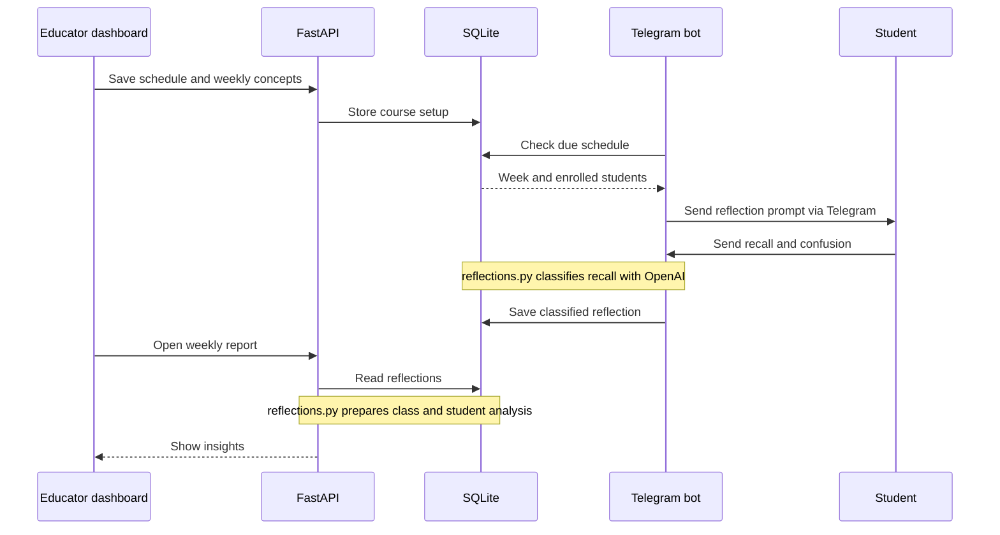
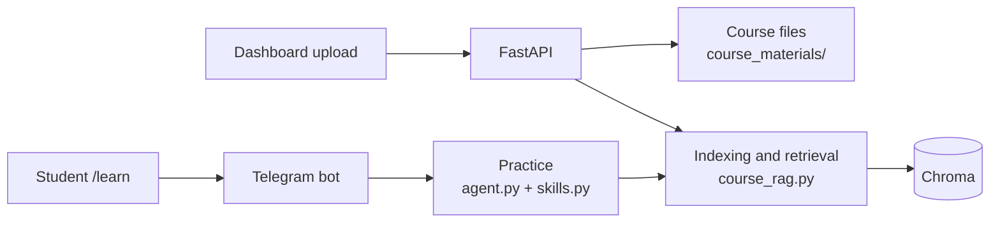

# Micro-Adaptive

Micro-Adaptive is an AI-assisted weekly reflection prototype for university courses. Educators schedule a Telegram prompt asking students what they recall and what remains unclear. The system matches replies to weekly concepts and shows class and student signals in an educator dashboard. Students can also use optional course-grounded practice and revision.

## Run locally

Run these commands from the **project root**. The API, dashboard, and bot are separate processes; keep each in its own terminal.

**Requirements:** Python 3.10+, Node.js 20.9+, an OpenAI API key, and a Telegram bot token for student onboarding and messages. The token is also needed by the dashboard invite page.

1. Create `src/.env` (or edit your existing local copy):

   ```env
   OPENAI_API_KEY=your_openai_api_key
   BOT_TOKEN=your_telegram_bot_token
   # Optional: OPENAI_MODEL=gpt-4o-mini
   ```

   The API, bot, and standalone agent load this file. Keep it out of Git.

2. Install Python dependencies and start the API (terminal 1):

   ```bash
   python3 -m venv .venv
   source .venv/bin/activate
   python -m pip install -r src/requirements.txt
   PYTHONPATH=src python -m uvicorn src.api:app --reload --host 127.0.0.1 --port 8000
   ```

   Check [http://127.0.0.1:8000/health](http://127.0.0.1:8000/health); it should return `{"status":"ok"}`. API docs are at [http://127.0.0.1:8000/docs](http://127.0.0.1:8000/docs).

3. Start the educator dashboard (terminal 2):

   ```bash
   cd educator-dashboard
   npm ci
   npm run dev
   ```

   Open [http://localhost:3000](http://localhost:3000). The dashboard uses `http://127.0.0.1:8000` by default. If the API runs elsewhere, set `NEXT_PUBLIC_API_BASE` in `educator-dashboard/.env.local` before starting Next.js.

4. Start the Telegram bot (terminal 3, from the project root):

   ```bash
   source .venv/bin/activate
   PYTHONPATH=src python src/bot.py
   ```

   The bot uses Telegram long polling and runs its scheduler in the same process. Keep it running for onboarding, replies, scheduled prompts, and manual sends. Run only one bot instance for a token.

5. In the dashboard, register or log in, then follow **Course → Schedule → Upload → Concepts → Teaching intention → Invite**. Set the course start date, teaching weeks, and push day/time, but leave pushes off during setup. Tag each upload with its teaching week. Review the course concepts and their week links. Then enable pushes from **Dashboard → Schedule** and share the invite link so students can open the bot and complete `/start`.

   To try a prompt without waiting for the weekly time, use **Dashboard → Schedule → Send now**. The API queues the request in SQLite; the running bot picks it up on its next scheduler check. The current week needs uploaded material and linked concepts. A class digest is scheduled 24 hours after a push when there are replies; it can also be requested from the schedule page.

On Windows, activate the virtual environment with `.venv\Scripts\activate` instead of `source .venv/bin/activate`.

## Architecture

### Weekly reflection (main flow)



The API and bot run separately and communicate through the **same SQLite file**.
The API also stores manual “send now” requests there; the bot's scheduler picks
them up. Both classification and report analysis use `src/reflections.py`.

### Course materials and optional practice



Uploads are `.pdf` or `.txt` files saved under `course_materials/<course_id>/`.
`course_rag.py` embeds their chunks in `chroma_db/`; the optional LangGraph
practice path retrieves them. `/revise` uses `revision.py` and student data in
SQLite. These paths use OpenAI; the weekly reflection loop does not run through
the LangGraph agent.

## Main files

| Path | Role |
| --- | --- |
| `src/api.py` | Dashboard API, course setup, materials, schedule, reports |
| `src/bot.py` | Telegram onboarding, conversation, weekly push and digest |
| `src/reflections.py` | Recall classification, follow-up, class analysis and digest text |
| `src/database.py` | Shared SQLite data and scheduling state |
| `src/course_rag.py` | PDF/text loading, chunking, embeddings and retrieval |
| `src/agent.py`, `src/skills.py` | Optional LangGraph practice activities and feedback |
| `src/revision.py` | Student `/revise` summary and blind spots |
| `educator-dashboard/` | Next.js educator interface |
| `evaluation/` | Evaluation scripts and fixtures |
| `langgraph.json` | Optional LangGraph development configuration |

`micro_adaptive.db`, `chroma_db/`, and uploaded course directories are local runtime data. A fresh checkout creates them as the application runs.

## Student commands

`/start` joins the course through the invite link. `/help`, `/learn`, `/progress`, `/memory`, `/history`, and `/revise` support the optional tutoring flow. Weekly reflection prompts arrive from the educator's schedule; students do not trigger them with a command.

## Troubleshooting

| Symptom | Check |
| --- | --- |
| Dashboard shows `Failed to fetch` | Confirm the API health URL above and that `NEXT_PUBLIC_API_BASE` points to it. |
| `BOT_TOKEN not set in .env` | Add `BOT_TOKEN` to `src/.env`, then restart the bot. |
| Invite link fails | The API also needs `BOT_TOKEN` and access to Telegram's `getMe` endpoint. |
| No weekly prompt | Keep the bot running; enable pushes; set a valid course start date; upload material for the current week; link concepts to that week. Check **Dashboard → Schedule**. |
| Upload or RAG fails | Check `OPENAI_API_KEY`, use a nonempty `.pdf` or `.txt`, and confirm the upload returned `status: uploaded`. |
| `ModuleNotFoundError` | Activate `.venv` and reinstall `src/requirements.txt`. |

## Prototype limits

This is a local, single-active-course prototype. Scheduling uses the machine's local time, and the bot keeps the current conversation step in memory, so an in-progress exchange can be lost on restart. The API's educator login does not enforce session authorization on the other routes; do not expose this setup as a public service or use it for real student data without adding access control.
